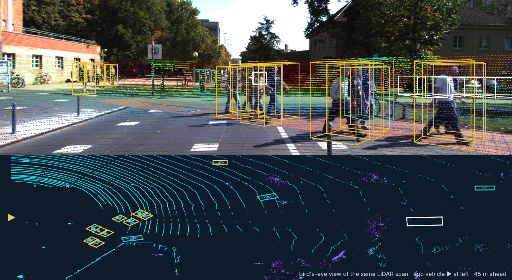

<p align="center">
  
</p>

<p align="center">
  <a href="https://github.com/milinpatel07/Autonomous-Driving_AI-Safety-and-Security/actions/workflows/ci.yml"></a>
  <a href="https://milinpatel07.github.io/Autonomous-Driving_AI-Safety-and-Security/"></a>
  <a href="https://colab.research.google.com/github/milinpatel07/Autonomous-Driving_AI-Safety-and-Security/blob/main/01_Perception/01_sae_levels_and_odd.ipynb"></a>
  <a href="LICENSE"></a>
  <a href="CITATION.cff"></a>
</p>

An open course on the safety and security of automated driving, from perception and prediction to the safety
case and the release decision. Fifty Jupyter notebooks cover perception and prediction, failure analysis,
functional safety (**ISO 26262**), safety of the intended functionality (**ISO 21448**), cybersecurity
(**ISO/SAE 21434**), safety of AI components (**ISO/PAS 8800**), runtime assurance, regulation and safety cases.
Each notebook runs on a CPU in Google Colab; 24 of them also
[run in the browser without an account](https://milinpatel07.github.io/Autonomous-Driving_AI-Safety-and-Security/run-in-browser).

<p align="center">
  <a href="https://milinpatel07.github.io/Autonomous-Driving_AI-Safety-and-Security/"><b>Website</b></a> ·
  <a href="#course-structure"><b>Course</b></a> ·
  <a href="#learning-paths"><b>Learning paths</b></a> ·
  <a href="#safety-case-benchmark-and-field-data"><b>Safety case, benchmark, field data</b></a> ·
  <a href="#the-avsafety-toolkit"><b>Toolkit</b></a> ·
  <a href="templates/"><b>Templates</b></a> ·
  <a href="#for-instructors"><b>Teaching</b></a>
</p>

## Motivation

The standards for automated driving specify which analyses and evidence a safety case needs: hazard analysis,
safety goals, triggering conditions, threat analysis, validation targets, field monitoring. They do not show how
to produce that evidence for a perception system, how to check it, or how to keep it valid when the system or its
data change. Teaching material usually stops at definitions and worked tables. This course fills that gap with
executable analyses on public data, connected by one worked example from the sensor to the release decision.

## Approach

- **Public data.** Detection, LiDAR processing, fusion, tracking and SOTIF triggering conditions are evaluated on
  KITTI camera images and LiDAR scans against ground truth; prediction uses NGSIM highway trajectories; intrusion
  detection uses the ROAD CAN-bus attack logs; field monitoring uses NHTSA crash reports. The V2X notebook uses the
  simulated VeReMi benchmark and says so. Synthetic data is used only where it is the appropriate choice and is
  labelled.
- **One worked example.** A pedestrian automatic emergency braking (AEB) function links the modules: detection and
  tracking, HARA, fault trees, SOTIF analysis and TARA lead to a GSN safety case and a release decision in the
  capstone.
- **Engineering work products.** Each notebook ends with an *In industry* section: the work product it supports
  (HARA, FMEDA, FTA, STPA, SOTIF analysis, TARA, safety case), who usually owns it and what assessors check.
- **Traceable sources.** Normative tables and formulas are implemented once in a tested toolkit. Every clause the
  course cites is recorded with its source and verification status in
  [`references/normative.yaml`](references/normative.yaml) and checked for consistency in CI; statements that could
  not be verified against a primary source are marked as such, and time-sensitive facts are dated.
- **Tested and maintained.** CI executes every notebook and runs the unit tests on each change. Monthly jobs check
  the cited regulations and datasets for new versions and re-run the course against the live sources
  ([MAINTAINING.md](MAINTAINING.md)).
- **Exercises.** Learners implement the methods themselves: a LiDAR object pipeline, a Kalman tracker, a trajectory
  predictor, a fault-tree evaluator, an STPA, a TARA, CAN and V2X intrusion detectors, conformal prediction, a
  safety-shielded motion planner and a safety case maintained as code.

<p align="center">
  
  <br><sub>A KITTI frame as used in the notebooks: LiDAR projected onto the camera image (coloured by distance), annotated 3D boxes for pedestrians, cyclists and cars, and the same scan from above. Data: KITTI, CC BY-NC-SA 3.0.</sub>
</p>

<p align="center">
  
</p>

## Course structure

| Module | Focus | Notebooks |
|---|---|---|
| [01 · Perception and Prediction](01_Perception/README.md) | SAE levels, ODD, real camera and LiDAR data, detection, VRUs, fusion, tracking, datasets, trajectory prediction | 9 |
| [02 · Failures and Robustness](02_Failures_and_Robustness/README.md) | incident investigations, corner cases, OOD detection, adversarial attacks | 4 |
| [03 · Functional Safety (ISO 26262)](03_Functional_Safety_ISO26262/README.md) | lifecycle, HARA, FMEA/FMEDA, fault tree analysis, STPA, V&V | 6 |
| [04 · SOTIF (ISO 21448)](04_SOTIF_ISO21448/README.md) | triggering conditions measured on real data, scenarios, OOD monitoring, simulation, RSS, a SOTIF perception benchmark | 6 |
| [05 · Cybersecurity (ISO/SAE 21434)](05_Cybersecurity_ISO21434/README.md) | framework, TARA, attack surfaces, CAN intrusion detection on real attack logs, V2X misbehaviour detection | 5 |
| [06 · AI Safety (ISO/PAS 8800)](06_AI_Safety_ISO_PAS_8800/README.md) | uncertainty, ensembles, calibration and conformal prediction on real detections, XAI, end-to-end and foundation models, statistical validation | 8 |
| [07 · Runtime Assurance and Operations](07_Runtime_Assurance_and_Operations/README.md) | runtime ODD monitoring, safe planning and fallback, human factors and takeover, V2X, field monitoring with NHTSA data, deployment | 6 |
| [08 · Standards, Regulation and Safety Case](08_Standards_Regulation_and_Safety_Case/README.md) | standards integration, type approval, gaps, GSN safety cases, capstone: AEB from requirement to release, continuous assurance | 6 |

Expand a module to open any notebook directly in Colab:

<!-- COURSE-TABLE:START -->
<details>
<summary><b>01 · Perception and Prediction</b> — 9 notebooks</summary>

| # | Notebook | Level | Open |
|---|---|---|---|
| 01-01 | [SAE Levels of Driving Automation and the Operational Design Domain](01_Perception/01_sae_levels_and_odd.ipynb) | Beginner | [](https://colab.research.google.com/github/milinpatel07/Autonomous-Driving_AI-Safety-and-Security/blob/main/01_Perception/01_sae_levels_and_odd.ipynb) |
| 01-02 | [Sensor Modalities: Camera, LiDAR and Radar](01_Perception/02_sensor_modalities.ipynb) | Beginner | [](https://colab.research.google.com/github/milinpatel07/Autonomous-Driving_AI-Safety-and-Security/blob/main/01_Perception/02_sensor_modalities.ipynb) |
| 01-03 | [LiDAR Sensors and Point Clouds](01_Perception/03_lidar_point_clouds.ipynb) | Intermediate | [](https://colab.research.google.com/github/milinpatel07/Autonomous-Driving_AI-Safety-and-Security/blob/main/01_Perception/03_lidar_point_clouds.ipynb) |
| 01-04 | [Object Detection on Real Driving Images: from IoU to Per-Class AP on KITTI](01_Perception/04_object_detection.ipynb) | Intermediate | [](https://colab.research.google.com/github/milinpatel07/Autonomous-Driving_AI-Safety-and-Security/blob/main/01_Perception/04_object_detection.ipynb) |
| 01-05 | [Vulnerable Road User Detection on Real Data: Recall, Range and AEB](01_Perception/05_vulnerable_road_user_detection.ipynb) | Intermediate | [](https://colab.research.google.com/github/milinpatel07/Autonomous-Driving_AI-Safety-and-Security/blob/main/01_Perception/05_vulnerable_road_user_detection.ipynb) |
| 01-06 | [Sensor Fusion: Calibration, Association and Late Fusion](01_Perception/06_sensor_fusion.ipynb) | Intermediate | [](https://colab.research.google.com/github/milinpatel07/Autonomous-Driving_AI-Safety-and-Security/blob/main/01_Perception/06_sensor_fusion.ipynb) |
| 01-07 | [Multi-Object Tracking and State Estimation](01_Perception/07_multi_object_tracking.ipynb) | Intermediate | [](https://colab.research.google.com/github/milinpatel07/Autonomous-Driving_AI-Safety-and-Security/blob/main/01_Perception/07_multi_object_tracking.ipynb) |
| 01-08 | [Driving Datasets: What KITTI Really Contains, and How to Specify Data for Safety](01_Perception/08_driving_datasets.ipynb) | Intermediate | [](https://colab.research.google.com/github/milinpatel07/Autonomous-Driving_AI-Safety-and-Security/blob/main/01_Perception/08_driving_datasets.ipynb) |
| 01-09 | [Trajectory Prediction on Real Highway Data](01_Perception/09_trajectory_prediction.ipynb) | Intermediate | [](https://colab.research.google.com/github/milinpatel07/Autonomous-Driving_AI-Safety-and-Security/blob/main/01_Perception/09_trajectory_prediction.ipynb) |

</details>

<details>
<summary><b>02 · Failures and Robustness</b> — 4 notebooks</summary>

| # | Notebook | Level | Open |
|---|---|---|---|
| 02-01 | [Real-World Incident Case Studies](02_Failures_and_Robustness/01_incident_case_studies.ipynb) | Beginner | [](https://colab.research.google.com/github/milinpatel07/Autonomous-Driving_AI-Safety-and-Security/blob/main/02_Failures_and_Robustness/01_incident_case_studies.ipynb) |
| 02-02 | [Corner Cases and Edge Cases](02_Failures_and_Robustness/02_corner_cases.ipynb) | Beginner | [](https://colab.research.google.com/github/milinpatel07/Autonomous-Driving_AI-Safety-and-Security/blob/main/02_Failures_and_Robustness/02_corner_cases.ipynb) |
| 02-03 | [Out-of-Distribution (OOD) Detection: Methods and Evaluation](02_Failures_and_Robustness/03_out_of_distribution_detection.ipynb) | Intermediate | [](https://colab.research.google.com/github/milinpatel07/Autonomous-Driving_AI-Safety-and-Security/blob/main/02_Failures_and_Robustness/03_out_of_distribution_detection.ipynb) |
| 02-04 | [Adversarial Attacks on Perception](02_Failures_and_Robustness/04_adversarial_attacks.ipynb) | Intermediate | [](https://colab.research.google.com/github/milinpatel07/Autonomous-Driving_AI-Safety-and-Security/blob/main/02_Failures_and_Robustness/04_adversarial_attacks.ipynb) |

</details>

<details>
<summary><b>03 · Functional Safety (ISO 26262)</b> — 6 notebooks</summary>

| # | Notebook | Level | Open |
|---|---|---|---|
| 03-01 | [ISO 26262: Functional Safety for Road Vehicles](03_Functional_Safety_ISO26262/01_iso26262_fundamentals.ipynb) | Beginner | [](https://colab.research.google.com/github/milinpatel07/Autonomous-Driving_AI-Safety-and-Security/blob/main/03_Functional_Safety_ISO26262/01_iso26262_fundamentals.ipynb) |
| 03-02 | [Hazard Analysis and Risk Assessment (HARA)](03_Functional_Safety_ISO26262/02_hara.ipynb) | Intermediate | [](https://colab.research.google.com/github/milinpatel07/Autonomous-Driving_AI-Safety-and-Security/blob/main/03_Functional_Safety_ISO26262/02_hara.ipynb) |
| 03-03 | [FMEA and FMEDA for Perception Hardware and Software](03_Functional_Safety_ISO26262/03_fmea_and_fmeda.ipynb) | Intermediate | [](https://colab.research.google.com/github/milinpatel07/Autonomous-Driving_AI-Safety-and-Security/blob/main/03_Functional_Safety_ISO26262/03_fmea_and_fmeda.ipynb) |
| 03-04 | [Fault Tree Analysis (FTA) and Dependent Failures](03_Functional_Safety_ISO26262/04_fault_tree_analysis.ipynb) | Intermediate | [](https://colab.research.google.com/github/milinpatel07/Autonomous-Driving_AI-Safety-and-Security/blob/main/03_Functional_Safety_ISO26262/04_fault_tree_analysis.ipynb) |
| 03-05 | [STPA: System-Theoretic Process Analysis](03_Functional_Safety_ISO26262/05_stpa.ipynb) | Intermediate | [](https://colab.research.google.com/github/milinpatel07/Autonomous-Driving_AI-Safety-and-Security/blob/main/03_Functional_Safety_ISO26262/05_stpa.ipynb) |
| 03-06 | [Verification and Validation for Functional Safety](03_Functional_Safety_ISO26262/06_verification_and_validation.ipynb) | Intermediate | [](https://colab.research.google.com/github/milinpatel07/Autonomous-Driving_AI-Safety-and-Security/blob/main/03_Functional_Safety_ISO26262/06_verification_and_validation.ipynb) |

</details>

<details>
<summary><b>04 · SOTIF (ISO 21448)</b> — 6 notebooks</summary>

| # | Notebook | Level | Open |
|---|---|---|---|
| 04-01 | [ISO 21448: Safety of the Intended Functionality (SOTIF)](04_SOTIF_ISO21448/01_sotif_fundamentals.ipynb) | Intermediate | [](https://colab.research.google.com/github/milinpatel07/Autonomous-Driving_AI-Safety-and-Security/blob/main/04_SOTIF_ISO21448/01_sotif_fundamentals.ipynb) |
| 04-02 | [Triggering Conditions and Scenario-Based Evaluation](04_SOTIF_ISO21448/02_triggering_conditions_and_scenarios.ipynb) | Intermediate | [](https://colab.research.google.com/github/milinpatel07/Autonomous-Driving_AI-Safety-and-Security/blob/main/04_SOTIF_ISO21448/02_triggering_conditions_and_scenarios.ipynb) |
| 04-03 | [OOD Monitoring as a SOTIF Safety Measure](04_SOTIF_ISO21448/03_ood_monitoring_as_safety_measure.ipynb) | Intermediate | [](https://colab.research.google.com/github/milinpatel07/Autonomous-Driving_AI-Safety-and-Security/blob/main/04_SOTIF_ISO21448/03_ood_monitoring_as_safety_measure.ipynb) |
| 04-04 | [Simulation-Based SOTIF Validation](04_SOTIF_ISO21448/04_simulation_based_validation.ipynb) | Advanced | [](https://colab.research.google.com/github/milinpatel07/Autonomous-Driving_AI-Safety-and-Security/blob/main/04_SOTIF_ISO21448/04_simulation_based_validation.ipynb) |
| 04-05 | [Criticality Metrics and Responsibility-Sensitive Safety (RSS)](04_SOTIF_ISO21448/05_criticality_metrics_and_rss.ipynb) | Intermediate | [](https://colab.research.google.com/github/milinpatel07/Autonomous-Driving_AI-Safety-and-Security/blob/main/04_SOTIF_ISO21448/05_criticality_metrics_and_rss.ipynb) |
| 04-06 | [An Open SOTIF Perception Benchmark](04_SOTIF_ISO21448/06_sotif_benchmark.ipynb) | Advanced | [](https://colab.research.google.com/github/milinpatel07/Autonomous-Driving_AI-Safety-and-Security/blob/main/04_SOTIF_ISO21448/06_sotif_benchmark.ipynb) |

</details>

<details>
<summary><b>05 · Cybersecurity (ISO/SAE 21434)</b> — 5 notebooks</summary>

| # | Notebook | Level | Open |
|---|---|---|---|
| 05-01 | [ISO/SAE 21434: Automotive Cybersecurity Engineering](05_Cybersecurity_ISO21434/01_iso21434_fundamentals.ipynb) | Beginner | [](https://colab.research.google.com/github/milinpatel07/Autonomous-Driving_AI-Safety-and-Security/blob/main/05_Cybersecurity_ISO21434/01_iso21434_fundamentals.ipynb) |
| 05-02 | [Threat Analysis and Risk Assessment (TARA)](05_Cybersecurity_ISO21434/02_tara.ipynb) | Intermediate | [](https://colab.research.google.com/github/milinpatel07/Autonomous-Driving_AI-Safety-and-Security/blob/main/05_Cybersecurity_ISO21434/02_tara.ipynb) |
| 05-03 | [Attack Surface Analysis for Autonomous Vehicles](05_Cybersecurity_ISO21434/03_attack_surface_analysis.ipynb) | Intermediate | [](https://colab.research.google.com/github/milinpatel07/Autonomous-Driving_AI-Safety-and-Security/blob/main/05_Cybersecurity_ISO21434/03_attack_surface_analysis.ipynb) |
| 05-04 | [CAN Bus Security and Intrusion Detection](05_Cybersecurity_ISO21434/04_can_bus_intrusion_detection.ipynb) | Advanced | [](https://colab.research.google.com/github/milinpatel07/Autonomous-Driving_AI-Safety-and-Security/blob/main/05_Cybersecurity_ISO21434/04_can_bus_intrusion_detection.ipynb) |
| 05-05 | [V2X Misbehaviour Detection](05_Cybersecurity_ISO21434/05_v2x_misbehaviour_detection.ipynb) | Advanced | [](https://colab.research.google.com/github/milinpatel07/Autonomous-Driving_AI-Safety-and-Security/blob/main/05_Cybersecurity_ISO21434/05_v2x_misbehaviour_detection.ipynb) |

</details>

<details>
<summary><b>06 · AI Safety (ISO/PAS 8800)</b> — 8 notebooks</summary>

| # | Notebook | Level | Open |
|---|---|---|---|
| 06-01 | [AI Safety Standards for Automated Driving: ISO/PAS 8800 and Related Standards](06_AI_Safety_ISO_PAS_8800/01_ai_safety_standards.ipynb) | Intermediate | [](https://colab.research.google.com/github/milinpatel07/Autonomous-Driving_AI-Safety-and-Security/blob/main/06_AI_Safety_ISO_PAS_8800/01_ai_safety_standards.ipynb) |
| 06-02 | [Uncertainty Types in Deep Learning](06_AI_Safety_ISO_PAS_8800/02_uncertainty_types.ipynb) | Intermediate | [](https://colab.research.google.com/github/milinpatel07/Autonomous-Driving_AI-Safety-and-Security/blob/main/06_AI_Safety_ISO_PAS_8800/02_uncertainty_types.ipynb) |
| 06-03 | [Monte Carlo Dropout and Deep Ensembles](06_AI_Safety_ISO_PAS_8800/03_mc_dropout_and_deep_ensembles.ipynb) | Intermediate | [](https://colab.research.google.com/github/milinpatel07/Autonomous-Driving_AI-Safety-and-Security/blob/main/06_AI_Safety_ISO_PAS_8800/03_mc_dropout_and_deep_ensembles.ipynb) |
| 06-04 | [Calibration and Reliability of Classifier Confidence](06_AI_Safety_ISO_PAS_8800/04_calibration.ipynb) | Intermediate | [](https://colab.research.google.com/github/milinpatel07/Autonomous-Driving_AI-Safety-and-Security/blob/main/06_AI_Safety_ISO_PAS_8800/04_calibration.ipynb) |
| 06-05 | [Conformal Prediction: Distribution-Free Uncertainty Guarantees](06_AI_Safety_ISO_PAS_8800/05_conformal_prediction.ipynb) | Intermediate/Advanced | [](https://colab.research.google.com/github/milinpatel07/Autonomous-Driving_AI-Safety-and-Security/blob/main/06_AI_Safety_ISO_PAS_8800/05_conformal_prediction.ipynb) |
| 06-06 | [Explainability (XAI) for Perception: Methods, Sanity Checks and Limits as Safety Evidence](06_AI_Safety_ISO_PAS_8800/06_explainability.ipynb) | Intermediate | [](https://colab.research.google.com/github/milinpatel07/Autonomous-Driving_AI-Safety-and-Security/blob/main/06_AI_Safety_ISO_PAS_8800/06_explainability.ipynb) |
| 06-07 | [End-to-End and Foundation-Model Driving: What Changes for Safety](06_AI_Safety_ISO_PAS_8800/07_end_to_end_and_foundation_models.ipynb) | Advanced | [](https://colab.research.google.com/github/milinpatel07/Autonomous-Driving_AI-Safety-and-Security/blob/main/06_AI_Safety_ISO_PAS_8800/07_end_to_end_and_foundation_models.ipynb) |
| 06-08 | [Statistical Safety Validation of ML-Based Perception and Automated Driving](06_AI_Safety_ISO_PAS_8800/08_statistical_safety_validation.ipynb) | Intermediate | [](https://colab.research.google.com/github/milinpatel07/Autonomous-Driving_AI-Safety-and-Security/blob/main/06_AI_Safety_ISO_PAS_8800/08_statistical_safety_validation.ipynb) |

</details>

<details>
<summary><b>07 · Runtime Assurance and Operations</b> — 6 notebooks</summary>

| # | Notebook | Level | Open |
|---|---|---|---|
| 07-01 | [ODD Specification and Runtime Monitoring](07_Runtime_Assurance_and_Operations/01_odd_and_runtime_monitoring.ipynb) | Intermediate | [](https://colab.research.google.com/github/milinpatel07/Autonomous-Driving_AI-Safety-and-Security/blob/main/07_Runtime_Assurance_and_Operations/01_odd_and_runtime_monitoring.ipynb) |
| 07-02 | [Safe Motion Planning and Fallback](07_Runtime_Assurance_and_Operations/02_safe_motion_planning_and_fallback.ipynb) | Advanced | [](https://colab.research.google.com/github/milinpatel07/Autonomous-Driving_AI-Safety-and-Security/blob/main/07_Runtime_Assurance_and_Operations/02_safe_motion_planning_and_fallback.ipynb) |
| 07-03 | [Human Factors: Supervision, Takeover and Misuse](07_Runtime_Assurance_and_Operations/03_human_factors_and_takeover.ipynb) | Intermediate | [](https://colab.research.google.com/github/milinpatel07/Autonomous-Driving_AI-Safety-and-Security/blob/main/07_Runtime_Assurance_and_Operations/03_human_factors_and_takeover.ipynb) |
| 07-04 | [V2X and Cooperative Driving](07_Runtime_Assurance_and_Operations/04_v2x_cooperative_driving.ipynb) | Intermediate | [](https://colab.research.google.com/github/milinpatel07/Autonomous-Driving_AI-Safety-and-Security/blob/main/07_Runtime_Assurance_and_Operations/04_v2x_cooperative_driving.ipynb) |
| 07-05 | [Field Safety Monitoring with Real Crash Reports](07_Runtime_Assurance_and_Operations/05_field_safety_monitoring.ipynb) | Intermediate | [](https://colab.research.google.com/github/milinpatel07/Autonomous-Driving_AI-Safety-and-Security/blob/main/07_Runtime_Assurance_and_Operations/05_field_safety_monitoring.ipynb) |
| 07-06 | [Industry Deployment: Status, Evidence and Operations](07_Runtime_Assurance_and_Operations/06_industry_deployment.ipynb) | Intermediate | [](https://colab.research.google.com/github/milinpatel07/Autonomous-Driving_AI-Safety-and-Security/blob/main/07_Runtime_Assurance_and_Operations/06_industry_deployment.ipynb) |

</details>

<details>
<summary><b>08 · Standards, Regulation and Safety Case</b> — 6 notebooks</summary>

| # | Notebook | Level | Open |
|---|---|---|---|
| 08-01 | [Standards Integration: How ISO 26262, ISO 21448, ISO/SAE 21434 and ISO/PAS 8800 Work Together](08_Standards_Regulation_and_Safety_Case/01_standards_integration.ipynb) | Intermediate | [](https://colab.research.google.com/github/milinpatel07/Autonomous-Driving_AI-Safety-and-Security/blob/main/08_Standards_Regulation_and_Safety_Case/01_standards_integration.ipynb) |
| 08-02 | [Automotive Regulation and Type Approval for Automated Driving](08_Standards_Regulation_and_Safety_Case/02_regulation_and_type_approval.ipynb) | Intermediate | [](https://colab.research.google.com/github/milinpatel07/Autonomous-Driving_AI-Safety-and-Security/blob/main/08_Standards_Regulation_and_Safety_Case/02_regulation_and_type_approval.ipynb) |
| 08-03 | [Standards Gaps and Open Problems in AV Safety](08_Standards_Regulation_and_Safety_Case/03_standards_gaps.ipynb) | Advanced | [](https://colab.research.google.com/github/milinpatel07/Autonomous-Driving_AI-Safety-and-Security/blob/main/08_Standards_Regulation_and_Safety_Case/03_standards_gaps.ipynb) |
| 08-04 | [Safety Cases and Goal Structuring Notation (GSN)](08_Standards_Regulation_and_Safety_Case/04_safety_case_gsn.ipynb) | Advanced | [](https://colab.research.google.com/github/milinpatel07/Autonomous-Driving_AI-Safety-and-Security/blob/main/08_Standards_Regulation_and_Safety_Case/04_safety_case_gsn.ipynb) |
| 08-05 | [Capstone: Pedestrian AEB from Requirement to Release Decision](08_Standards_Regulation_and_Safety_Case/05_capstone_aeb_from_requirement_to_release.ipynb) | Advanced | [](https://colab.research.google.com/github/milinpatel07/Autonomous-Driving_AI-Safety-and-Security/blob/main/08_Standards_Regulation_and_Safety_Case/05_capstone_aeb_from_requirement_to_release.ipynb) |
| 08-06 | [Continuous Assurance: Maintaining the Safety Case as Code](08_Standards_Regulation_and_Safety_Case/06_continuous_assurance.ipynb) | Advanced | [](https://colab.research.google.com/github/milinpatel07/Autonomous-Driving_AI-Safety-and-Security/blob/main/08_Standards_Regulation_and_Safety_Case/06_continuous_assurance.ipynb) |

</details>

<!-- COURSE-TABLE:END -->

## Learning paths

| Goal | Path |
|---|---|
| **Complete course** | 01 → 02 → 03 → 04 → 05 → 06 → 07 → 08, ending with the capstone 08-05 and continuous assurance 08-06 |
| **Functional safety engineer** | 03-01 → 03-02 → 03-03 → 03-04 → 03-05 → 03-06 → 08-04 → 08-05 → 08-06 |
| **SOTIF / perception safety engineer** | 01-04 → 01-05 → 04-01 → 04-02 → 04-03 → 04-05 → 04-06 → 06-08 |
| **ML / perception engineer** | 01-02 → 01-03 → 01-04 → 01-06 → 01-07 → 01-09 → 06-02 … 06-05 → 06-07 |
| **Security engineer** | 05-01 → 05-02 → 05-03 → 05-04 → 05-05 → 02-04 → 07-04 → 08-01 |
| **Validation and operations** | 04-02 → 04-04 → 06-08 → 07-01 → 07-02 → 07-03 → 07-05 |
| **Manager, assessor, regulator** | 01-01 → 02-01 → 08-01 → 08-02 → 07-05 → 08-04 → 08-05 → 08-06 |
| **Short introduction** | 01-01 → 03-02 → 08-05 and the [interactive tools](#interactive-tools) |

The [industry map](https://milinpatel07.github.io/Autonomous-Driving_AI-Safety-and-Security/industry/) links every
engineering work product (HARA, FMEDA, FTA, STPA, SOTIF analysis, TARA, safety case …) to the notebooks and tools
that support it.

## Safety case, benchmark and field data

Three artefacts are generated from code and checked automatically rather than maintained by hand:

| | Content | How it is kept current |
|---|---|---|
| [**Safety case as code**](https://milinpatel07.github.io/Autonomous-Driving_AI-Safety-and-Security/safety-case) | The capstone's pedestrian-AEB safety argument as code ([`safety_case/`](safety_case/README.md), `avsafety.assurance`): every claim is linked to the notebook and metric that produce its evidence | CI re-runs the producing notebooks on each change and reports any claim whose status flips; evidence from changed code is marked stale ([08-06](08_Standards_Regulation_and_Safety_Case/06_continuous_assurance.ipynb)) |
| [**SOTIF perception benchmark**](https://milinpatel07.github.io/Autonomous-Driving_AI-Safety-and-Security/benchmark) | Any camera detector on 120 KITTI frames under physically modelled fog, low light and lens dirt: recall with confidence intervals, a triggering-condition table, the supported speed and a release verdict against a declared requirement; optional LiDAR track on SOTIF-PCOD | Versioned split; results submitted by pull request are validated against a schema ([04-06](04_SOTIF_ISO21448/06_sotif_benchmark.ipynb), [`benchmark/`](benchmark/README.md)) |
| [**Field-safety statistics**](https://milinpatel07.github.io/Autonomous-Driving_AI-Safety-and-Security/observatory) | NHTSA Standing General Order crash reports for ADS and Level 2 ADAS, California DMV disengagements and published exposure, with the caveats needed to read them | Rebuilt from the official files every month (`scripts/observatory.py`, run by the website workflow) |

```bash
python -m avsafety.bench --model torchvision:fasterrcnn_mobilenet_v3_large_fpn --out results.json   # benchmark a detector
python scripts/safety_case.py --report                                                              # evaluate the safety case
```

## Interactive tools

Browser calculators that work on a phone and offline, using exactly the same tables as the toolkit (CI checks that
they agree):

| Tool | What it does |
|---|---|
| [ASIL calculator](https://milinpatel07.github.io/Autonomous-Driving_AI-Safety-and-Security/tools/asil.html) | Severity × exposure × controllability → ASIL, with decomposition options (ISO 26262-3, -9) |
| [TARA risk calculator](https://milinpatel07.github.io/Autonomous-Driving_AI-Safety-and-Security/tools/tara.html) | Attack potential, attack vector or CVSS v3.1 → feasibility → risk value and CAL (ISO/SAE 21434) |
| [RSS safe distance](https://milinpatel07.github.io/Autonomous-Driving_AI-Safety-and-Security/tools/rss.html) | Responsibility-Sensitive Safety minimum gap, TTC, headway and DRAC |
| [How many miles?](https://milinpatel07.github.io/Autonomous-Driving_AI-Safety-and-Security/tools/miles.html) | Failure-free distance needed to demonstrate a target rate (Kalra & Paddock, 2016) |

## For instructors

The course can be adopted as a whole (a 14-week, 5-ECTS semester plan or a 5-day industry training) or notebook by
notebook. The [teaching guide](https://milinpatel07.github.io/Autonomous-Driving_AI-Safety-and-Security/teaching)
gives assessable learning outcomes per module, the schedule, an assessment design with a rubric for the capstone, and
how institutions can certify results. Notebooks in Modules 03, 04 and 05 contain auto-checked exercises
(`avsafety.exercises`), and [`classroom/`](classroom/README.md) is an autograded assignment template whose tests
compute every reference answer with the toolkit.

## The avsafety toolkit

The normative tables and formulas used across the course, as a small pip-installable package with unit tests
pinned to the standards and published references:

```bash
pip install "avsafety[data] @ git+https://github.com/milinpatel07/Autonomous-Driving_AI-Safety-and-Security.git"
```

```python
from avsafety import iso26262, iso21434, sotif, validation

iso26262.determine_asil("S3", "E4", "C2")                       # 'C'
iso21434.cvss31_base_score("CVSS:3.1/AV:N/AC:L/PR:N/UI:N/S:U/C:H/I:H/A:H")  # 9.8
sotif.rss_safe_longitudinal_distance(v_rear=25.0, v_front=20.0)  # metres
validation.miles_to_demonstrate(1.09e-8, confidence=0.95)        # ≈ 275 million miles

from avsafety import data                                        # public datasets, fetched on demand
frame = data.kitti_object(4747)        # camera image, LiDAR scan, 3D labels and calibration of one KITTI frame
crashes = data.nhtsa_sgo("ADS")        # NHTSA Standing General Order crash reports
```

See [avsafety/README.md](avsafety/README.md) for all modules: ISO 26262 (ASIL, decomposition, SPFM/LFM/PMHF),
ISO/SAE 21434 (attack potential, risk, CAL, CVSS), SOTIF metrics and RSS, statistical validation, uncertainty
(calibration, temperature scaling, conformal prediction), scenario coverage, physically based perturbations, the
SOTIF benchmark, the safety case as code, auto-checked exercises, and real-data loaders for KITTI, NGSIM, NHTSA crash
reports, ROAD CAN logs and VeReMi V2X messages.

## Templates

Editable templates with worked examples that match the notebooks:
[HARA (ISO 26262)](templates/HARA_Template.md) ·
[SOTIF analysis (ISO 21448)](templates/SOTIF_Analysis_Template.md) ·
[TARA (ISO/SAE 21434)](templates/TARA_Template.md)

## Getting started

**Google Colab (recommended):** click any *Open in Colab* badge. Nothing to install: real-data notebooks install
the course toolkit and download the files they need on first run.

**In your browser, no account:** [24 notebooks](https://milinpatel07.github.io/Autonomous-Driving_AI-Safety-and-Security/run-in-browser)
run entirely in the web browser (JupyterLite and Pyodide): no login, no installation, nothing leaves your device, and
it works where Colab is blocked. Notebooks that need PyTorch or the KITTI and NHTSA downloads run on Colab.

**Deutsche Ausgabe:** die sechs Kern-Notebooks (SAE-Stufen und ODD, G&R/HARA, SOTIF, TARA, ISO/PAS 8800,
Abschlussprojekt AEB) auf Deutsch – [de/README.md](de/README.md).

**Locally:**

```bash
git clone https://github.com/milinpatel07/Autonomous-Driving_AI-Safety-and-Security.git
cd Autonomous-Driving_AI-Safety-and-Security
python -m venv .venv && source .venv/bin/activate      # Windows: .venv\Scripts\activate
pip install -r requirements.txt
pip install -e ".[data,assurance,bench]"      # the course toolkit with real-data loaders, safety case and benchmark
jupyter lab
```

The notebooks need Python 3.9 or later and run on a CPU. For local GPU acceleration, install PyTorch following the
[official instructions](https://pytorch.org/get-started/locally/).

## Research background

The course draws on the author's research on SOTIF, uncertainty and assurance of ML-based perception at
Hochschule Kempten, for example:

- Patel, M., & Jung, R. (2026). Integrating cybersecurity into the AI safety assurance argument: A GSN pattern for AI-based perception components in highly automated driving. In *Computer Safety, Reliability, and Security. SAFECOMP 2026 Workshops*, LNCS, pp. 763–779. Springer. [doi:10.1007/978-3-032-35506-5_55](https://doi.org/10.1007/978-3-032-35506-5_55)
- Patel, M., & Jung, R. (2026). Uncertainty evaluation to support safety of the intended functionality analysis for identifying performance insufficiencies in ML-based LiDAR object detection. *VEHITS 2026*. [doi:10.5220/0014967200004030](https://doi.org/10.5220/0014967200004030)
- Patel, M., Jung, R., & Khatun, M. (2025). A systematic literature review on safety of the intended functionality for automated driving systems. *SAE Technical Paper* 2025-01-5030. [doi:10.4271/2025-01-5030](https://doi.org/10.4271/2025-01-5030)

More on the [About page](https://milinpatel07.github.io/Autonomous-Driving_AI-Safety-and-Security/about).

## Contributing

Corrections, new topics, benchmark results and translations are welcome. See [CONTRIBUTING.md](CONTRIBUTING.md),
[MAINTAINING.md](MAINTAINING.md), the [changelog](CHANGELOG.md) and the [roadmap](ROADMAP.md).

## Citation

```bibtex
@misc{patel_av_safety_security,
  author    = {Patel, Milin},
  title     = {Autonomous Driving: AI Safety and Security -- an open course},
  year      = {2026},
  publisher = {GitHub},
  url       = {https://github.com/milinpatel07/Autonomous-Driving_AI-Safety-and-Security}
}
```

## Licence and disclaimer

[MIT Licence](LICENSE) © 2025–2026 Milin Patel. The material is for education: it explains standards and
regulations but does not reproduce or replace them, and it is not legal or certification advice.
