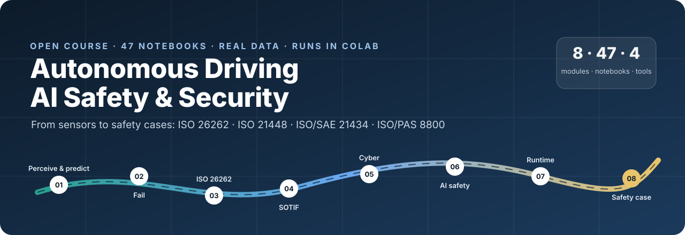
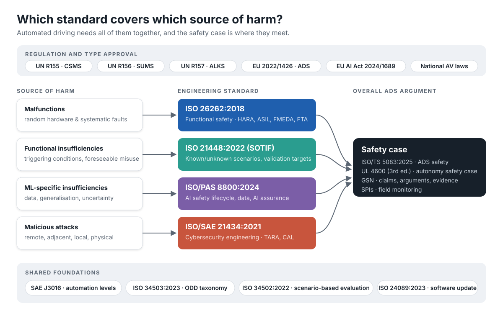

<p align="center">
  
</p>

<p align="center">
  <a href="https://github.com/milinpatel07/Autonomous-Driving_AI-Safety-and-Security/actions/workflows/ci.yml"></a>
  <a href="https://milinpatel07.github.io/Autonomous-Driving_AI-Safety-and-Security/"></a>
  <a href="https://colab.research.google.com/github/milinpatel07/Autonomous-Driving_AI-Safety-and-Security/blob/main/01_Perception/01_sae_levels_and_odd.ipynb"></a>
  <a href="LICENSE"></a>
  <a href="CITATION.cff"></a>
</p>

**An open, runnable course on the safety and security of automated driving** — from how a vehicle perceives the
world to how you argue that it is safe and secure enough to deploy. Forty Jupyter notebooks cover perception,
real-world failures, **ISO 26262**, **ISO 21448 (SOTIF)**, **ISO/SAE 21434**, **ISO/PAS 8800**, runtime assurance,
regulation and safety cases. Every notebook opens in Google Colab with one click and runs on a CPU without
downloading datasets.

<p align="center">
  <a href="https://milinpatel07.github.io/Autonomous-Driving_AI-Safety-and-Security/"><b>Website</b></a> ·
  <a href="#the-course"><b>Course</b></a> ·
  <a href="#interactive-tools"><b>Interactive tools</b></a> ·
  <a href="#the-avsafety-toolkit"><b>Toolkit</b></a> ·
  <a href="templates/"><b>Templates</b></a> ·
  <a href="#learning-paths"><b>Learning paths</b></a>
</p>

## Why this course

- **End to end.** A recurring worked example, an automatic emergency braking (AEB) function that protects pedestrians, links the modules: from detection and tracking through HARA, fault trees, SOTIF and TARA to a GSN safety case.
- **Correct and sourced.** Every notebook has been reviewed against the standards and primary sources (NTSB, NHTSA, UNECE, EUR-Lex, peer-reviewed papers). Normative tables are implemented once in a tested toolkit, and time-sensitive facts are dated.
- **Runnable and tested.** Continuous integration executes every notebook, runs the toolkit's unit tests and checks every link and Colab badge on each change.
- **Hands-on.** You build things: a Kalman tracker, a fault-tree engine, a TARA pipeline, a CAN intrusion detector, conformal prediction sets, an RSS controller and a safety-case checker.

<p align="center">
  
</p>

## The course

| Module | Focus | Notebooks |
|---|---|---|
| [01 · Perception Systems](01_Perception/README.md) | SAE levels, ODD, sensors, LiDAR, detection, VRUs, fusion, tracking, datasets | 8 |
| [02 · Failures and Robustness](02_Failures_and_Robustness/README.md) | incident investigations, corner cases, OOD detection, adversarial attacks | 4 |
| [03 · Functional Safety (ISO 26262)](03_Functional_Safety_ISO26262/README.md) | lifecycle, HARA, FMEA/FMEDA, fault tree analysis, V&V | 5 |
| [04 · SOTIF (ISO 21448)](04_SOTIF_ISO21448/README.md) | triggering conditions, scenarios, OOD monitoring, simulation, RSS | 5 |
| [05 · Cybersecurity (ISO/SAE 21434)](05_Cybersecurity_ISO21434/README.md) | framework, TARA, attack surfaces, CAN intrusion detection | 4 |
| [06 · AI Safety (ISO/PAS 8800)](06_AI_Safety_ISO_PAS_8800/README.md) | uncertainty, ensembles, calibration, conformal prediction, XAI, statistical validation | 7 |
| [07 · Runtime Assurance and Operations](07_Runtime_Assurance_and_Operations/README.md) | runtime ODD monitoring, V2X, deployment landscape | 3 |
| [08 · Standards, Regulation and Safety Case](08_Standards_Regulation_and_Safety_Case/README.md) | standards integration, type approval, gaps, GSN safety cases | 4 |

Expand a module to open any notebook directly in Colab:

<!-- COURSE-TABLE:START -->
<details>
<summary><b>01 · Perception Systems</b> — 8 notebooks</summary>

| # | Notebook | Level | Open |
|---|---|---|---|
| 01-01 | [SAE Levels of Driving Automation and the Operational Design Domain](01_Perception/01_sae_levels_and_odd.ipynb) | Beginner | [](https://colab.research.google.com/github/milinpatel07/Autonomous-Driving_AI-Safety-and-Security/blob/main/01_Perception/01_sae_levels_and_odd.ipynb) |
| 01-02 | [Sensor Modalities: Camera, LiDAR and Radar](01_Perception/02_sensor_modalities.ipynb) | Beginner | [](https://colab.research.google.com/github/milinpatel07/Autonomous-Driving_AI-Safety-and-Security/blob/main/01_Perception/02_sensor_modalities.ipynb) |
| 01-03 | [LiDAR Sensors and Point Clouds](01_Perception/03_lidar_point_clouds.ipynb) | Intermediate | [](https://colab.research.google.com/github/milinpatel07/Autonomous-Driving_AI-Safety-and-Security/blob/main/01_Perception/03_lidar_point_clouds.ipynb) |
| 01-04 | [Object Detection: from IoU to mAP with YOLO](01_Perception/04_object_detection.ipynb) | Intermediate | [](https://colab.research.google.com/github/milinpatel07/Autonomous-Driving_AI-Safety-and-Security/blob/main/01_Perception/04_object_detection.ipynb) |
| 01-05 | [Vulnerable Road User Detection: a Safety-Critical Case Study](01_Perception/05_vulnerable_road_user_detection.ipynb) | Intermediate | [](https://colab.research.google.com/github/milinpatel07/Autonomous-Driving_AI-Safety-and-Security/blob/main/01_Perception/05_vulnerable_road_user_detection.ipynb) |
| 01-06 | [Sensor Fusion: Calibration, Association and Late Fusion](01_Perception/06_sensor_fusion.ipynb) | Intermediate | [](https://colab.research.google.com/github/milinpatel07/Autonomous-Driving_AI-Safety-and-Security/blob/main/01_Perception/06_sensor_fusion.ipynb) |
| 01-07 | [Multi-Object Tracking and State Estimation](01_Perception/07_multi_object_tracking.ipynb) | Intermediate | [](https://colab.research.google.com/github/milinpatel07/Autonomous-Driving_AI-Safety-and-Security/blob/main/01_Perception/07_multi_object_tracking.ipynb) |
| 01-08 | [Driving Datasets and 3D Detection Metrics](01_Perception/08_driving_datasets.ipynb) | Intermediate | [](https://colab.research.google.com/github/milinpatel07/Autonomous-Driving_AI-Safety-and-Security/blob/main/01_Perception/08_driving_datasets.ipynb) |

</details>

<details>
<summary><b>02 · Failures and Robustness</b> — 4 notebooks</summary>

| # | Notebook | Level | Open |
|---|---|---|---|
| 02-01 | [Real-World Incident Case Studies](02_Failures_and_Robustness/01_incident_case_studies.ipynb) | Beginner | [](https://colab.research.google.com/github/milinpatel07/Autonomous-Driving_AI-Safety-and-Security/blob/main/02_Failures_and_Robustness/01_incident_case_studies.ipynb) |
| 02-02 | [Corner Cases and Edge Cases](02_Failures_and_Robustness/02_corner_cases.ipynb) | Beginner | [](https://colab.research.google.com/github/milinpatel07/Autonomous-Driving_AI-Safety-and-Security/blob/main/02_Failures_and_Robustness/02_corner_cases.ipynb) |
| 02-03 | [Out-of-Distribution (OOD) Detection: Methods and Evaluation](02_Failures_and_Robustness/03_out_of_distribution_detection.ipynb) | Intermediate | [](https://colab.research.google.com/github/milinpatel07/Autonomous-Driving_AI-Safety-and-Security/blob/main/02_Failures_and_Robustness/03_out_of_distribution_detection.ipynb) |
| 02-04 | [Adversarial Attacks on Perception](02_Failures_and_Robustness/04_adversarial_attacks.ipynb) | Intermediate | [](https://colab.research.google.com/github/milinpatel07/Autonomous-Driving_AI-Safety-and-Security/blob/main/02_Failures_and_Robustness/04_adversarial_attacks.ipynb) |

</details>

<details>
<summary><b>03 · Functional Safety (ISO 26262)</b> — 5 notebooks</summary>

| # | Notebook | Level | Open |
|---|---|---|---|
| 03-01 | [ISO 26262: Functional Safety for Road Vehicles](03_Functional_Safety_ISO26262/01_iso26262_fundamentals.ipynb) | Beginner | [](https://colab.research.google.com/github/milinpatel07/Autonomous-Driving_AI-Safety-and-Security/blob/main/03_Functional_Safety_ISO26262/01_iso26262_fundamentals.ipynb) |
| 03-02 | [Hazard Analysis and Risk Assessment (HARA)](03_Functional_Safety_ISO26262/02_hara.ipynb) | Intermediate | [](https://colab.research.google.com/github/milinpatel07/Autonomous-Driving_AI-Safety-and-Security/blob/main/03_Functional_Safety_ISO26262/02_hara.ipynb) |
| 03-03 | [FMEA and FMEDA for Perception Hardware and Software](03_Functional_Safety_ISO26262/03_fmea_and_fmeda.ipynb) | Intermediate | [](https://colab.research.google.com/github/milinpatel07/Autonomous-Driving_AI-Safety-and-Security/blob/main/03_Functional_Safety_ISO26262/03_fmea_and_fmeda.ipynb) |
| 03-04 | [Fault Tree Analysis (FTA) and Dependent Failures](03_Functional_Safety_ISO26262/04_fault_tree_analysis.ipynb) | Intermediate | [](https://colab.research.google.com/github/milinpatel07/Autonomous-Driving_AI-Safety-and-Security/blob/main/03_Functional_Safety_ISO26262/04_fault_tree_analysis.ipynb) |
| 03-05 | [Verification and Validation for Functional Safety](03_Functional_Safety_ISO26262/06_verification_and_validation.ipynb) | Intermediate | [](https://colab.research.google.com/github/milinpatel07/Autonomous-Driving_AI-Safety-and-Security/blob/main/03_Functional_Safety_ISO26262/06_verification_and_validation.ipynb) |

</details>

<details>
<summary><b>04 · SOTIF (ISO 21448)</b> — 5 notebooks</summary>

| # | Notebook | Level | Open |
|---|---|---|---|
| 04-01 | [ISO 21448: Safety of the Intended Functionality (SOTIF)](04_SOTIF_ISO21448/01_sotif_fundamentals.ipynb) | Intermediate | [](https://colab.research.google.com/github/milinpatel07/Autonomous-Driving_AI-Safety-and-Security/blob/main/04_SOTIF_ISO21448/01_sotif_fundamentals.ipynb) |
| 04-02 | [Triggering Conditions and Scenario-Based Evaluation](04_SOTIF_ISO21448/02_triggering_conditions_and_scenarios.ipynb) | Intermediate | [](https://colab.research.google.com/github/milinpatel07/Autonomous-Driving_AI-Safety-and-Security/blob/main/04_SOTIF_ISO21448/02_triggering_conditions_and_scenarios.ipynb) |
| 04-03 | [OOD Monitoring as a SOTIF Safety Measure](04_SOTIF_ISO21448/03_ood_monitoring_as_safety_measure.ipynb) | Intermediate | [](https://colab.research.google.com/github/milinpatel07/Autonomous-Driving_AI-Safety-and-Security/blob/main/04_SOTIF_ISO21448/03_ood_monitoring_as_safety_measure.ipynb) |
| 04-04 | [Simulation-Based SOTIF Validation](04_SOTIF_ISO21448/04_simulation_based_validation.ipynb) | Advanced | [](https://colab.research.google.com/github/milinpatel07/Autonomous-Driving_AI-Safety-and-Security/blob/main/04_SOTIF_ISO21448/04_simulation_based_validation.ipynb) |
| 04-05 | [Criticality Metrics and Responsibility-Sensitive Safety (RSS)](04_SOTIF_ISO21448/05_criticality_metrics_and_rss.ipynb) | Intermediate | [](https://colab.research.google.com/github/milinpatel07/Autonomous-Driving_AI-Safety-and-Security/blob/main/04_SOTIF_ISO21448/05_criticality_metrics_and_rss.ipynb) |

</details>

<details>
<summary><b>05 · Cybersecurity (ISO/SAE 21434)</b> — 4 notebooks</summary>

| # | Notebook | Level | Open |
|---|---|---|---|
| 05-01 | [ISO/SAE 21434: Automotive Cybersecurity Engineering](05_Cybersecurity_ISO21434/01_iso21434_fundamentals.ipynb) | Beginner | [](https://colab.research.google.com/github/milinpatel07/Autonomous-Driving_AI-Safety-and-Security/blob/main/05_Cybersecurity_ISO21434/01_iso21434_fundamentals.ipynb) |
| 05-02 | [Threat Analysis and Risk Assessment (TARA)](05_Cybersecurity_ISO21434/02_tara.ipynb) | Intermediate | [](https://colab.research.google.com/github/milinpatel07/Autonomous-Driving_AI-Safety-and-Security/blob/main/05_Cybersecurity_ISO21434/02_tara.ipynb) |
| 05-03 | [Attack Surface Analysis for Autonomous Vehicles](05_Cybersecurity_ISO21434/03_attack_surface_analysis.ipynb) | Intermediate | [](https://colab.research.google.com/github/milinpatel07/Autonomous-Driving_AI-Safety-and-Security/blob/main/05_Cybersecurity_ISO21434/03_attack_surface_analysis.ipynb) |
| 05-04 | [CAN Bus Security and Intrusion Detection](05_Cybersecurity_ISO21434/04_can_bus_intrusion_detection.ipynb) | Advanced | [](https://colab.research.google.com/github/milinpatel07/Autonomous-Driving_AI-Safety-and-Security/blob/main/05_Cybersecurity_ISO21434/04_can_bus_intrusion_detection.ipynb) |

</details>

<details>
<summary><b>06 · AI Safety (ISO/PAS 8800)</b> — 7 notebooks</summary>

| # | Notebook | Level | Open |
|---|---|---|---|
| 06-01 | [AI Safety Standards for Automated Driving: ISO/PAS 8800 and Related Standards](06_AI_Safety_ISO_PAS_8800/01_ai_safety_standards.ipynb) | Intermediate | [](https://colab.research.google.com/github/milinpatel07/Autonomous-Driving_AI-Safety-and-Security/blob/main/06_AI_Safety_ISO_PAS_8800/01_ai_safety_standards.ipynb) |
| 06-02 | [Uncertainty Types in Deep Learning](06_AI_Safety_ISO_PAS_8800/02_uncertainty_types.ipynb) | Intermediate | [](https://colab.research.google.com/github/milinpatel07/Autonomous-Driving_AI-Safety-and-Security/blob/main/06_AI_Safety_ISO_PAS_8800/02_uncertainty_types.ipynb) |
| 06-03 | [Monte Carlo Dropout and Deep Ensembles](06_AI_Safety_ISO_PAS_8800/03_mc_dropout_and_deep_ensembles.ipynb) | Intermediate | [](https://colab.research.google.com/github/milinpatel07/Autonomous-Driving_AI-Safety-and-Security/blob/main/06_AI_Safety_ISO_PAS_8800/03_mc_dropout_and_deep_ensembles.ipynb) |
| 06-04 | [Calibration and Reliability of Classifier Confidence](06_AI_Safety_ISO_PAS_8800/04_calibration.ipynb) | Intermediate | [](https://colab.research.google.com/github/milinpatel07/Autonomous-Driving_AI-Safety-and-Security/blob/main/06_AI_Safety_ISO_PAS_8800/04_calibration.ipynb) |
| 06-05 | [Conformal Prediction: Distribution-Free Uncertainty Guarantees](06_AI_Safety_ISO_PAS_8800/05_conformal_prediction.ipynb) | Intermediate/Advanced | [](https://colab.research.google.com/github/milinpatel07/Autonomous-Driving_AI-Safety-and-Security/blob/main/06_AI_Safety_ISO_PAS_8800/05_conformal_prediction.ipynb) |
| 06-06 | [Explainability (XAI) for Perception: Methods, Sanity Checks and Limits as Safety Evidence](06_AI_Safety_ISO_PAS_8800/06_explainability.ipynb) | Intermediate | [](https://colab.research.google.com/github/milinpatel07/Autonomous-Driving_AI-Safety-and-Security/blob/main/06_AI_Safety_ISO_PAS_8800/06_explainability.ipynb) |
| 06-07 | [Statistical Safety Validation of ML-Based Perception and Automated Driving](06_AI_Safety_ISO_PAS_8800/08_statistical_safety_validation.ipynb) | Intermediate | [](https://colab.research.google.com/github/milinpatel07/Autonomous-Driving_AI-Safety-and-Security/blob/main/06_AI_Safety_ISO_PAS_8800/08_statistical_safety_validation.ipynb) |

</details>

<details>
<summary><b>07 · Runtime Assurance and Operations</b> — 3 notebooks</summary>

| # | Notebook | Level | Open |
|---|---|---|---|
| 07-01 | [ODD Specification and Runtime Monitoring](07_Runtime_Assurance_and_Operations/01_odd_and_runtime_monitoring.ipynb) | Intermediate | [](https://colab.research.google.com/github/milinpatel07/Autonomous-Driving_AI-Safety-and-Security/blob/main/07_Runtime_Assurance_and_Operations/01_odd_and_runtime_monitoring.ipynb) |
| 07-02 | [V2X and Cooperative Driving](07_Runtime_Assurance_and_Operations/04_v2x_cooperative_driving.ipynb) | Intermediate | [](https://colab.research.google.com/github/milinpatel07/Autonomous-Driving_AI-Safety-and-Security/blob/main/07_Runtime_Assurance_and_Operations/04_v2x_cooperative_driving.ipynb) |
| 07-03 | [Industry Deployment: Status, Evidence and Operations](07_Runtime_Assurance_and_Operations/06_industry_deployment.ipynb) | Intermediate | [](https://colab.research.google.com/github/milinpatel07/Autonomous-Driving_AI-Safety-and-Security/blob/main/07_Runtime_Assurance_and_Operations/06_industry_deployment.ipynb) |

</details>

<details>
<summary><b>08 · Standards, Regulation and Safety Case</b> — 4 notebooks</summary>

| # | Notebook | Level | Open |
|---|---|---|---|
| 08-01 | [Standards Integration: How ISO 26262, ISO 21448, ISO/SAE 21434 and ISO/PAS 8800 Work Together](08_Standards_Regulation_and_Safety_Case/01_standards_integration.ipynb) | Intermediate | [](https://colab.research.google.com/github/milinpatel07/Autonomous-Driving_AI-Safety-and-Security/blob/main/08_Standards_Regulation_and_Safety_Case/01_standards_integration.ipynb) |
| 08-02 | [Automotive Regulation and Type Approval for Automated Driving](08_Standards_Regulation_and_Safety_Case/02_regulation_and_type_approval.ipynb) | Intermediate | [](https://colab.research.google.com/github/milinpatel07/Autonomous-Driving_AI-Safety-and-Security/blob/main/08_Standards_Regulation_and_Safety_Case/02_regulation_and_type_approval.ipynb) |
| 08-03 | [Standards Gaps and Open Problems in AV Safety](08_Standards_Regulation_and_Safety_Case/03_standards_gaps.ipynb) | Advanced | [](https://colab.research.google.com/github/milinpatel07/Autonomous-Driving_AI-Safety-and-Security/blob/main/08_Standards_Regulation_and_Safety_Case/03_standards_gaps.ipynb) |
| 08-04 | [Safety Cases and Goal Structuring Notation (GSN)](08_Standards_Regulation_and_Safety_Case/04_safety_case_gsn.ipynb) | Advanced | [](https://colab.research.google.com/github/milinpatel07/Autonomous-Driving_AI-Safety-and-Security/blob/main/08_Standards_Regulation_and_Safety_Case/04_safety_case_gsn.ipynb) |

</details>

<!-- COURSE-TABLE:END -->

## Learning paths

| Goal | Path |
|---|---|
| **Complete course** | 01 → 02 → 03 → 04 → 05 → 06 → 07 → 08 |
| **Safety engineer** | 03 → 04 → 05 → 08 |
| **ML / perception engineer** | 01 → 02 → 06 → 04-03 → 07-01 |
| **Security engineer** | 05 → 02-04 → 07-02 → 08-01 |
| **Manager / regulator** | 01-01 → 02-01 → 03-01 → 04-01 → 05-01 → 06-01 → 08-02 → 08-04 |
| **One-hour taster** | 01-01 → 03-02 → the [interactive tools](#interactive-tools) |

## Interactive tools

Browser calculators that work on a phone and offline, using exactly the same tables as the toolkit (CI checks that
they agree):

| Tool | What it does |
|---|---|
| [ASIL calculator](https://milinpatel07.github.io/Autonomous-Driving_AI-Safety-and-Security/tools/asil.html) | Severity × exposure × controllability → ASIL, with decomposition options (ISO 26262-3, -9) |
| [TARA risk calculator](https://milinpatel07.github.io/Autonomous-Driving_AI-Safety-and-Security/tools/tara.html) | Attack potential, attack vector or CVSS v3.1 → feasibility → risk value and CAL (ISO/SAE 21434) |
| [RSS safe distance](https://milinpatel07.github.io/Autonomous-Driving_AI-Safety-and-Security/tools/rss.html) | Responsibility-Sensitive Safety minimum gap, TTC, headway and DRAC |
| [How many miles?](https://milinpatel07.github.io/Autonomous-Driving_AI-Safety-and-Security/tools/miles.html) | Failure-free distance needed to demonstrate a target rate (Kalra & Paddock, 2016) |

## The avsafety toolkit

The normative tables and formulas used across the course, as a small pip-installable package with unit tests
pinned to the standards and published references:

```bash
pip install "git+https://github.com/milinpatel07/Autonomous-Driving_AI-Safety-and-Security.git"
```

```python
from avsafety import iso26262, iso21434, sotif, validation

iso26262.determine_asil("S3", "E4", "C2")                       # 'C'
iso21434.cvss31_base_score("CVSS:3.1/AV:N/AC:L/PR:N/UI:N/S:U/C:H/I:H/A:H")  # 9.8
sotif.rss_safe_longitudinal_distance(v_rear=25.0, v_front=20.0)  # metres
validation.miles_to_demonstrate(1.09e-8, confidence=0.95)        # ≈ 275 million miles
```

See [avsafety/README.md](avsafety/README.md) for all modules: ISO 26262 (ASIL, decomposition, SPFM/LFM/PMHF),
ISO/SAE 21434 (attack potential, risk, CAL, CVSS), SOTIF metrics and RSS, statistical validation, uncertainty
(calibration, temperature scaling, conformal prediction) and scenario coverage.

## Templates

Professional, editable templates with worked examples that match the notebooks:
[HARA (ISO 26262)](templates/HARA_Template.md) ·
[SOTIF analysis (ISO 21448)](templates/SOTIF_Analysis_Template.md) ·
[TARA (ISO/SAE 21434)](templates/TARA_Template.md)

## Getting started

**Google Colab (recommended):** click any *Open in Colab* badge. Nothing to install.

**Locally:**

```bash
git clone https://github.com/milinpatel07/Autonomous-Driving_AI-Safety-and-Security.git
cd Autonomous-Driving_AI-Safety-and-Security
python -m venv .venv && source .venv/bin/activate      # Windows: .venv\Scripts\activate
pip install -r requirements.txt
jupyter lab
```

The notebooks need Python 3.9 or later and run on a CPU. For local GPU acceleration, install PyTorch following the
[official instructions](https://pytorch.org/get-started/locally/).

## Research behind the course

The course draws on the author's research on SOTIF, uncertainty and assurance of ML-based perception at
Hochschule Kempten, for example:

- Patel, M., & Jung, R. (2026). Integrating cybersecurity into the AI safety assurance argument: A GSN pattern for AI-based perception components in highly automated driving. In *Computer Safety, Reliability, and Security. SAFECOMP 2026 Workshops*, LNCS, pp. 763–779. Springer. [doi:10.1007/978-3-032-35506-5_55](https://doi.org/10.1007/978-3-032-35506-5_55)
- Patel, M., & Jung, R. (2026). Uncertainty evaluation to support safety of the intended functionality analysis for identifying performance insufficiencies in ML-based LiDAR object detection. *VEHITS 2026*. [doi:10.5220/0014967200004030](https://doi.org/10.5220/0014967200004030)
- Patel, M., Jung, R., & Khatun, M. (2025). A systematic literature review on safety of the intended functionality for automated driving systems. *SAE Technical Paper* 2025-01-5030. [doi:10.4271/2025-01-5030](https://doi.org/10.4271/2025-01-5030)

More on the [About page](https://milinpatel07.github.io/Autonomous-Driving_AI-Safety-and-Security/about).

## Contributing

Corrections, new topics and translations are welcome. See [CONTRIBUTING.md](CONTRIBUTING.md) and the
[roadmap](ROADMAP.md) for ideas.

## Citation

```bibtex
@misc{patel_av_safety_security,
  author    = {Patel, Milin},
  title     = {Autonomous Driving: AI Safety and Security -- an open course},
  year      = {2026},
  publisher = {GitHub},
  url       = {https://github.com/milinpatel07/Autonomous-Driving_AI-Safety-and-Security}
}
```

## Licence and disclaimer

[MIT Licence](LICENSE) © 2025–2026 Milin Patel. The material is for education: it explains standards and
regulations but does not reproduce or replace them, and it is not legal or certification advice.
