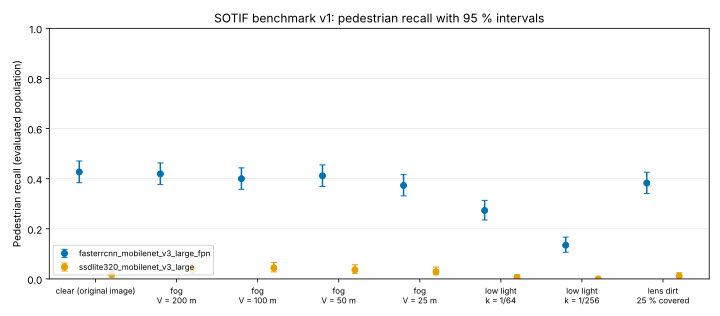

<!-- Built from benchmark/results/*.json by scripts/build_leaderboard.py; do not edit by hand. -->

A reproducible **SOTIF triggering-condition report** for camera object detectors: 120 KITTI frames (spec v1), evaluated in clear air and under physically modelled fog, low light and lens dirt. Each entry is a complete report — recall by distance, occlusion and truncation with confidence intervals, false positives per frame, a triggering-condition table, the speed limit the evidence supports, and a release verdict against the course's AEB pedestrian requirement PR-01. How to run it and how to submit: [benchmark/README.md](https://github.com/milinpatel07/Autonomous-Driving_AI-Safety-and-Security/blob/main/benchmark/README.md); walk-through: [04-06 SOTIF benchmark](../04_SOTIF_ISO21448/06_sotif_benchmark.ipynb).

## Leaderboard

Recall in % of the evaluated population [95 % Clopper–Pearson interval]; 520 pedestrians per condition. Sorted by clear-air pedestrian recall. A higher number is not a release: the verdict column applies the declared requirement.

| Detector | τ | Ped. clear | Ped. fog 50 m | Ped. fog 25 m | Ped. low light 1/256 | Ped. lens dirt | Cyclist clear | Car clear | Ped. FP/frame clear | PR-01 verdict | PR-01 speed, clear |
|---|---|---|---|---|---|---|---|---|---|---|---|
| [fasterrcnn_mobilenet_v3_large_fpn](https://github.com/milinpatel07/Autonomous-Driving_AI-Safety-and-Security/blob/main/benchmark/results/fasterrcnn_mobilenet_v3_large_fpn.json) | 0.5 | 42.7 [38–47] | 41.1 [37–46] | 37.3 [33–42] | 13.5 [11–17] | 38.3 [34–43] | 42.9 [31–55] | 76.5 [70–82] | 1.23 | DO NOT RELEASE | none |
| [ssdlite320_mobilenet_v3_large](https://github.com/milinpatel07/Autonomous-Driving_AI-Safety-and-Security/blob/main/benchmark/results/ssdlite320_mobilenet_v3_large.json) | 0.5 | 1.7 [1–3] | 3.6 [2–6] | 2.9 [2–5] | 0.0 [0–1] | 1.1 [0–2] | 1.4 [0–8] | 25.4 [20–32] | 0.01 | DO NOT RELEASE | none |

## Pedestrian recall per condition

## What the numbers can and cannot claim

- The fog, low light and lens dirt are **models applied to real daytime images** (KITTI has no real fog or night). They rank detectors under controlled, documented conditions; they do not replace real-condition data.
- Recall is **per frame**; 120 frames are not 120 independent encounters, and the frames come from one city. The intervals cover sampling noise only.
- The baselines are COCO-pretrained; KITTI classes are reached through a documented mapping (person → pedestrian, car/truck → car, person on bicycle → cyclist).
- KITTI is licensed CC BY-NC-SA 3.0 (non-commercial).
