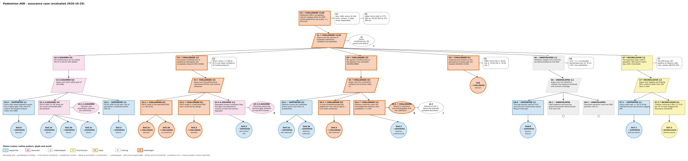

# Safety case status

The course's pedestrian AEB argument is kept as code: every solution in the GSN argument names the
notebook that produces its evidence and an acceptance criterion fixed in the argument. CI re-evaluates
the case on every change; a claim turns **challenged** when its regenerated evidence fails the criterion
or an assumption is contradicted, and **stale** when the code that produced its evidence has changed.
The method, its limits and the standards behind it (UL 4600 SPIs, ISO 21448 operation phase,
ISO/PAS 8800 measures during operation) are taught in
[08-06 Continuous assurance](../08_Standards_Regulation_and_Safety_Case/06_continuous_assurance.ipynb);
the files are in [`safety_case/`](https://github.com/milinpatel07/Autonomous-Driving_AI-Safety-and-Security/blob/main/safety_case/README.md).

Statuses are not a release approval. The case is intentionally incomplete and evaluates to
*do not release*, as the [capstone](../08_Standards_Regulation_and_Safety_Case/05_capstone_aeb_from_requirement_to_release.ipynb)
concludes; a green node means only that current evidence meets its criterion.

<!-- safety-case-status:start -->
*Evaluated on 2026-10-29 by `python scripts/safety_case.py --report` from `safety_case/aeb_pedestrian.yaml` and the committed evidence; do not edit this block by hand.*

**Result:** the top claim is **challenged**: the case does not support a release (goals: 5 supported, 3 assumed, 3 undeveloped, 2 inconclusive, 8 challenged; Baconian confidence 11|20 checks passed).

### Claims and evidence

| Node | Type | Claim / evidence | Status | Criterion → observed | Producer | Confidence |
|---|---|---|---|---|---|---|
| G1 | Goal | Pedestrian AEB is acceptably safe for release within its ODD (urban pedestrian sub-scope, <= 60 km/h) | ✗ **challenged** |  |  | 11\|20 |
| S1 | Strategy | Argue over the sources of hazardous behaviour, validation and operation | ✗ **challenged** |  |  | 11\|20 |
| G2 | Goal | E/E malfunctions do not violate SG-01 or SG-02 (ISO 26262) | A **assumed** |  |  | 5\|6 |
| S2 | Strategy | Argue over each safety goal of the HARA | A **assumed** |  |  | 5\|6 |
| G2.0 | Goal | Every ASIL-rated hazardous event has a safety goal; ASIL and FTTI used in the release analysis match the HARA | ✓ supported |  |  | 1\|1 |
| Sn2.0 | Solution | HARA summary recomputed in the capstone (08-05 section 2) | ✓ supported | `uncovered_events == 0 and sg01_asil == SG-01.asil and sg02_asil == SG-02.asil and sg01_ftti_ms == SG-01.ftti_ms and sg02_ftti_ms == SG-02.ftti_ms` → uncovered_events = 0 == 0; sg01_asil = D == D (SG-01.asil); sg02_asil = B == B (SG-02.asil); sg01_ftti_ms = 300 == 300 (SG-01.ftti_ms); sg02_ftti_ms = 500 == 500 (SG-02.ftti_ms) | [05_capstone_aeb_from_requirement_to_release](../08_Standards_Regulation_and_Safety_Case/05_capstone_aeb_from_requirement_to_release.ipynb) |  |
| G2.1 | Goal | SG-01 (ASIL D): E/E faults do not cause unintended AEB deceleration | A **assumed** |  |  | 3\|4 |
| A2.1 | Assumption | Decision and plausibility channels are sufficiently independent (DFA, 03-02) | A **assumed** | assumption without supporting evidence |  |  |
| Sn2.1a | Solution | ASIL decomposition of SG-01 is permitted by ISO 26262-9 | ✓ supported | `decomposition_sg01 in SG-01.decompositions` → decomposition_sg01 = [B(D), B(D)] in [[C(D), A(D)], [B(D), B(D)], [D(D), QM(D)]] (SG-01.decompositions) | [05_capstone_aeb_from_requirement_to_release](../08_Standards_Regulation_and_Safety_Case/05_capstone_aeb_from_requirement_to_release.ipynb) |  |
| Sn2.1b | Solution | Fault-tree check: top event rate below the PMHF target of the SG-01 ASIL | ✓ supported | `fta_top_event_per_h < SG-01.pmhf_target_per_h` → fta_top_event_per_h = 8e-10 < 1e-08 (SG-01.pmhf_target_per_h) | [05_capstone_aeb_from_requirement_to_release](../08_Standards_Regulation_and_Safety_Case/05_capstone_aeb_from_requirement_to_release.ipynb) |  |
| Sn2.1c | Solution | Fault handling time of every SG-01 mechanism within FTTI | ✓ supported | `fhti_max_sg01_ms <= SG-01.ftti_ms` → fhti_max_sg01_ms = 200 <= 300 (SG-01.ftti_ms) | [05_capstone_aeb_from_requirement_to_release](../08_Standards_Regulation_and_Safety_Case/05_capstone_aeb_from_requirement_to_release.ipynb) |  |
| G2.2 | Goal | SG-02 (ASIL B) E/E part: loss of perception is detected within 500 ms | ✓ supported |  |  | 1\|1 |
| Sn2.2 | Solution | Frame-loss detection timing | ✓ supported | `fhti_max_sg02_ms <= SG-02.ftti_ms` → fhti_max_sg02_ms = 300 <= 500 (SG-02.ftti_ms) | [05_capstone_aeb_from_requirement_to_release](../08_Standards_Regulation_and_Safety_Case/05_capstone_aeb_from_requirement_to_release.ipynb) |  |
| G3 | Goal | Functional insufficiencies of pedestrian perception are acceptably reduced (ISO 21448) | ✗ **challenged** |  |  | 1\|5 |
| S3 | Strategy | Argue over the performance requirement PR-01 and runtime measures | ✗ **challenged** |  |  | 1\|5 |
| G3.1 | Goal | PR-01 holds in the specified ODD (<= 60 km/h) | ✗ **challenged** |  |  | 0\|2 |
| Sn3.1a | Solution | PR-01 check on 40 KITTI frames (capstone 4.5) | ✗ **challenged** | `recall_lower_95 >= 0.90` — criterion not met: recall_lower_95 = 0.646 >= 0.9 | [05_capstone_aeb_from_requirement_to_release](../08_Standards_Regulation_and_Safety_Case/05_capstone_aeb_from_requirement_to_release.ipynb) |  |
| Sn3.1b | Solution | Supplier detector reaches recall 0.90 at some operating threshold (01-05) | ✗ **challenged** | `max_recall_any_threshold >= 0.90` — criterion not met: max_recall_any_threshold = 0.556 >= 0.9 | [05_vulnerable_road_user_detection](../01_Perception/05_vulnerable_road_user_detection.ipynb) |  |
| G3.2 | Goal | PR-01 holds in a restricted ODD that is enforced by design | ✗ **challenged** |  |  | 0\|1 |
| Sn3.2 | Solution | Speed-dependent PR-01 check (capstone 4.5) | ✗ **challenged** | `v_star_kmh != null` — criterion not met: v_star_kmh = null != null | [05_capstone_aeb_from_requirement_to_release](../08_Standards_Regulation_and_Safety_Case/05_capstone_aeb_from_requirement_to_release.ipynb) |  |
| G3.3 | Goal | Degraded camera conditions (fog, low light) are detected at runtime so that the function degrades | A **assumed** |  |  | 1\|2 |
| A3.3 | Assumption | Physically based fog and low light rendered on real KITTI frames represent real degradations | A **assumed** | assumption without supporting evidence |  |  |
| Sn3.3 | Solution | OOD monitor: requirement R-MON-1, TPR >= 0.90 at 95 % confidence (04-03) | ✓ supported | `tpr_lower_95 >= 0.90` → tpr_lower_95 = 0.905 >= 0.9 | [03_ood_monitoring_as_safety_measure](../04_SOTIF_ISO21448/03_ood_monitoring_as_safety_measure.ipynb) |  |
| G4 | Goal | ML-specific insufficiencies of the detector are controlled (ISO/PAS 8800) | ✗ **challenged** |  |  | 3\|5 |
| S4 | Strategy | Argue over the uncertainty evidence the function relies on | ✗ **challenged** |  |  | 3\|5 |
| G4.1 | Goal | Detector scores are calibrated where fusion uses them as probabilities | ✓ supported |  |  | 2\|2 |
| Sn4.1a | Solution | Person-score ECE after temperature scaling, held-out frames (capstone 5) | ✓ supported | `ece_after <= 0.05` → ece_after = 0.022 <= 0.05 | [05_capstone_aeb_from_requirement_to_release](../08_Standards_Regulation_and_Safety_Case/05_capstone_aeb_from_requirement_to_release.ipynb) |  |
| Sn4.1b | Solution | Detection ECE after Platt scaling, held-out frames (06-04) | ✓ supported | `dece_platt <= 0.05` → dece_platt = 0.026 <= 0.05 | [04_calibration](../06_AI_Safety_ISO_PAS_8800/04_calibration.ipynb) |  |
| G4.2 | Goal | A score threshold bounds the pedestrian miss rate at alpha = 0.10 (split conformal) | ✗ **challenged** |  |  | 0\|1 |
| Sn4.2 | Solution | Conformal recall threshold and held-out check (capstone 5) | ✗ **challenged** | `tau_conf > 0.01 and heldout_recall >= heldout_recall_min` — criterion not met: tau_conf = 0 > 0.01; heldout_recall = 0.867 >= 0.811 (heldout_recall_min) | [05_capstone_aeb_from_requirement_to_release](../08_Standards_Regulation_and_Safety_Case/05_capstone_aeb_from_requirement_to_release.ipynb) |  |
| G4.3 | Goal | Distance intervals cover the true pedestrian distance with probability >= 0.90 | ✗ **challenged** |  |  | 1\|2 |
| A4.3 | Assumption | Objects in operation are exchangeable with the calibration objects (incl. truncated ones) | ✗ **challenged** | `coverage_truncated >= 0.88` — criterion not met: coverage_truncated = 0.304 >= 0.88 | [05_conformal_prediction](../06_AI_Safety_ISO_PAS_8800/05_conformal_prediction.ipynb) |  |
| Sn4.3 | Solution | Mondrian conformal intervals, pedestrian test coverage (06-05) | ✓ supported | `coverage_pedestrian >= 0.88` → coverage_pedestrian = 0.899 >= 0.88 | [05_conformal_prediction](../06_AI_Safety_ISO_PAS_8800/05_conformal_prediction.ipynb) |  |
| G5 | Goal | Cybersecurity threats on the perception-to-brake path are treated (ISO/SAE 21434) | ✗ **challenged** |  |  | 0\|1 |
| Sn5 | Solution | TARA summary: residual risks and CALs (capstone 6) | ✗ **challenged** | `open_threats == 0 and cal_ts01 == TS-01.cal and cal_ts02 == TS-02.cal and cal_ts03 == TS-03.cal and cal_ts04 == TS-04.cal` — criterion not met: open_threats = 1 == 0; cal_ts01 = 4 == 4 (TS-01.cal); cal_ts02 = 4 == 4 (TS-02.cal); cal_ts03 = 2 == 2 (TS-03.cal); cal_ts04 = 2 == 2 (TS-04.cal) | [05_capstone_aeb_from_requirement_to_release](../08_Standards_Regulation_and_Safety_Case/05_capstone_aeb_from_requirement_to_release.ipynb) |  |
| G6 | Goal | Validation targets V-01 and V-02 are demonstrated for the ODD | ◇ **undeveloped** |  |  | 1\|1 |
| S6 | Strategy | Argue over the statistical method, the exposure achieved and scenario coverage | ◇ **undeveloped** |  |  | 1\|1 |
| G6.0 | Goal | The rate bounds used for V-01 and V-02 are conservative (exact Poisson intervals) | ✓ supported |  |  | 1\|1 |
| Sn6.0 | Solution | Monte Carlo coverage of the exact Poisson interval (06-08) | ✓ supported | `simulated_coverage >= nominal_coverage` → simulated_coverage = 0.963 >= 0.95 (nominal_coverage) | [08_statistical_safety_validation](../06_AI_Safety_ISO_PAS_8800/08_statistical_safety_validation.ipynb) |  |
| G6.1 | Goal | Fleet exposure and proving-ground encounters demonstrate V-01 and V-02 | ◇ **undeveloped** |  | [08_statistical_safety_validation](../06_AI_Safety_ISO_PAS_8800/08_statistical_safety_validation.ipynb) | 0\|0 |
| G6.2 | Goal | Executed scenarios cover the ODD pairwise (100 %) | ◇ **undeveloped** |  | [04_simulation_based_validation](../04_SOTIF_ISO21448/04_simulation_based_validation.ipynb) | 0\|0 |
| G7 | Goal | The argument stays valid in operation: SPIs tied to claims stay within thresholds | ? **inconclusive** |  |  | 1\|2 |
| S7 | Strategy | Argue over lagging and leading SPIs; evidence older than 200 days is stale | ? **inconclusive** |  |  | 1\|2 |
| G7.1 | Goal | Injury-crash rate <= 50 % of the matched human benchmark (lagging SPI) | ✓ supported |  |  | 1\|1 |
| Sn7.1 | Solution | Injury-crash SPI, 12 months, exact Poisson 95 % interval (07-05) | ✓ supported | `injury_high <= injury_threshold` → injury_high = 0.729 <= 1.876 (injury_threshold) | [05_field_safety_monitoring](../07_Runtime_Assurance_and_Operations/05_field_safety_monitoring.ipynb) |  |
| G7.2 | Goal | Crashes involving a VRU <= 0.10 per 10^6 miles (lagging SPI, illustrative threshold) | ? **inconclusive** |  |  | 0\|1 |
| Sn7.2 | Solution | VRU-crash SPI, 12 months, exact Poisson 95 % interval (07-05) | ? **inconclusive** | `vru_high <= vru_threshold` — criterion not met (vru_high = 0.118 <= 0.1 (vru_threshold)), refutation not met (vru_low = 0.033 > 0.1 (vru_threshold)) | [05_field_safety_monitoring](../07_Runtime_Assurance_and_Operations/05_field_safety_monitoring.ipynb) |  |

### Evidence register

| Evidence | Producer | Recorded (UTC) | Code hash | Dataset | Licence |
|---|---|---|---|---|---|
| `aeb-calibration` | [05_capstone_aeb_from_requirement_to_release](../08_Standards_Regulation_and_Safety_Case/05_capstone_aeb_from_requirement_to_release.ipynb) | 2026-10-29 08:47 | `2def87cb6e6261ba` | KITTI object detection, 40 training frames (left camera) | CC BY-NC-SA 3.0 |
| `aeb-conformal` | [05_capstone_aeb_from_requirement_to_release](../08_Standards_Regulation_and_Safety_Case/05_capstone_aeb_from_requirement_to_release.ipynb) | 2026-10-29 08:47 | `2def87cb6e6261ba` | KITTI object detection, 40 training frames (left camera) | CC BY-NC-SA 3.0 |
| `aeb-fsc` | [05_capstone_aeb_from_requirement_to_release](../08_Standards_Regulation_and_Safety_Case/05_capstone_aeb_from_requirement_to_release.ipynb) | 2026-10-29 08:47 | `2def87cb6e6261ba` | none (analysis with illustrative ratings and rates) | n/a |
| `aeb-hara` | [05_capstone_aeb_from_requirement_to_release](../08_Standards_Regulation_and_Safety_Case/05_capstone_aeb_from_requirement_to_release.ipynb) | 2026-10-29 08:47 | `2def87cb6e6261ba` | none (analysis with illustrative ratings and rates) | n/a |
| `aeb-pr01` | [05_capstone_aeb_from_requirement_to_release](../08_Standards_Regulation_and_Safety_Case/05_capstone_aeb_from_requirement_to_release.ipynb) | 2026-10-29 08:47 | `2def87cb6e6261ba` | KITTI object detection, 40 training frames (left camera) | CC BY-NC-SA 3.0 |
| `aeb-tara` | [05_capstone_aeb_from_requirement_to_release](../08_Standards_Regulation_and_Safety_Case/05_capstone_aeb_from_requirement_to_release.ipynb) | 2026-10-29 08:47 | `2def87cb6e6261ba` | none (analysis with illustrative ratings and rates) | n/a |
| `detection-calibration-kitti` | [04_calibration](../06_AI_Safety_ISO_PAS_8800/04_calibration.ipynb) | 2026-10-29 08:44 | `b355582a8eaadb46` | KITTI object detection, 40 training frames (20 held out) | CC BY-NC-SA 3.0 |
| `distance-conformal-kitti` | [05_conformal_prediction](../06_AI_Safety_ISO_PAS_8800/05_conformal_prediction.ipynb) | 2026-10-29 08:44 | `9f1766b5699c280d` | KITTI object detection labels, all 7,481 training frames | CC BY-NC-SA 3.0 |
| `field-spi-waymo` | [05_field_safety_monitoring](../07_Runtime_Assurance_and_Operations/05_field_safety_monitoring.ipynb) | 2026-10-29 08:47 | `b9c9830c48f3e137` | NHTSA SGO 2021-01 ADS reports; Waymo Safety Impact Data Hub (data through June 2026) | NHTSA: public US government data; Waymo hub: published for research and reproduction |
| `ood-monitor-kitti` | [03_ood_monitoring_as_safety_measure](../04_SOTIF_ISO21448/03_ood_monitoring_as_safety_measure.ipynb) | 2026-10-29 08:42 | `25b7c51ee034baab` | KITTI object detection, 30 frames with LiDAR; fog and low light rendered | CC BY-NC-SA 3.0 |
| `poisson-interval-coverage` | [08_statistical_safety_validation](../06_AI_Safety_ISO_PAS_8800/08_statistical_safety_validation.ipynb) | 2026-10-29 08:46 | `3db79bbe27f33406` | none (Monte Carlo analysis) | n/a |
| `vru-recall-kitti` | [05_vulnerable_road_user_detection](../01_Perception/05_vulnerable_road_user_detection.ipynb) | 2026-10-29 08:35 | `79d36fe940c986e0` | KITTI object detection, 40 training frames (left camera) | CC BY-NC-SA 3.0 |
<!-- safety-case-status:end -->
